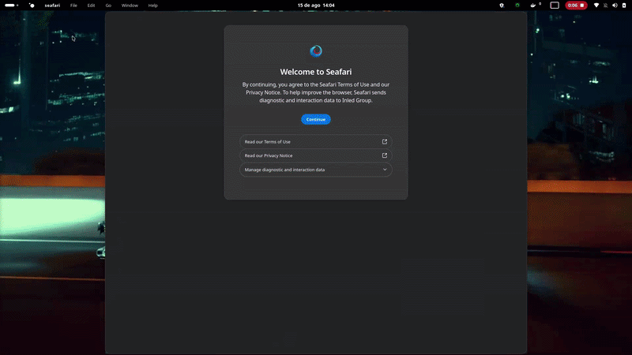
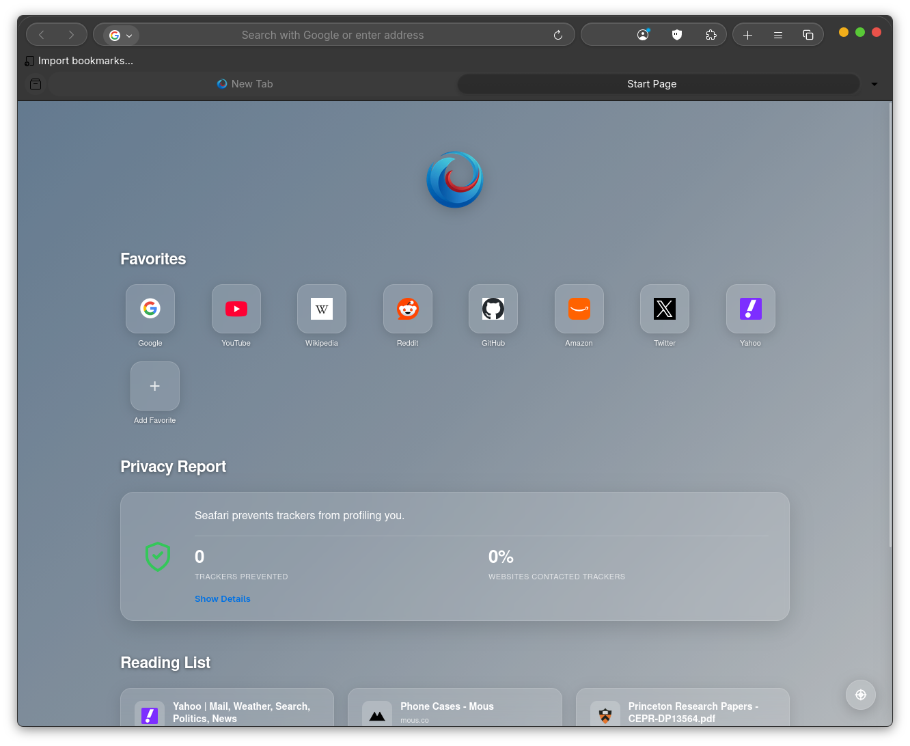

<div align="left">
  
  <h1>Seafari for Windows</h1>
</div>

**Seafari for Windows** is the official Windows port of [InledGroup/seafari](https://github.com/InledGroup/seafari) — the macOS Safari-styled browser built on top of Mozilla Firefox.

It tracks Mozilla's latest Windows (`win64`) Firefox releases and upstream [InledGroup/seafari](https://github.com/InledGroup/seafari) updates daily via automated GitHub Actions, packaging both a **Windows Installer (`.exe`)** and a **Portable Archive (`.zip`)**.

**We are proud to announce that Seafari is the default browser for Pear OS, now adapted for Windows 10 & 11.**

<p align="center">
  
</p>

<p align="center">
  
</p>

<p align="center">
  
</p>

---

## What Makes Seafari Different

You're probably wondering why create a new browser when you can start from a Chromium clone. The problem is that Chromium limits user freedom and extension capabilities (Manifest V3 ad-blocker restrictions).

Seafari is based on **Mozilla Firefox**, giving you complete browsing freedom, container tabs, and genuine **uBlock Origin** tracker protection with blocked request counters displayed directly on the Safari Start Page.

---

## Windows Port Enhancements

- **Native macOS Left Traffic Lights**: Close, Minimize, and Maximize buttons are anchored on the left in authentic macOS order (`[Close | Minimize | Maximize]`) with simultaneous triad hover glyphs (`x`, `–`, `+`) and click rings.
- **Genuine Windows Shell & Taskbar Identity**: Patched Win32 PE metadata (`VS_VERSIONINFO`, `RT_MANIFEST`, `RT_STRING`) and `AppUserModelID = "InledGroup.Seafari"` so Windows Taskbar, Task Manager, Alt+Tab, and Start Menu identify it as **"Seafari"** with the high-resolution macOS compass icon.
- **2-Second Smooth Pre-Launch Hold**: Holds the initial window transparent for 2 seconds while CSS stylesheets, XUL trees, and extensions finish loading offscreen, then reveals the browser with a fluid macOS spring zoom/fade-in.
- **Zero Crash Reporter Nagging**: Seafari Crash Reporter and Breakpad telemetry daemons are completely disabled (`[Crash Reporter] Enabled=0`, `crashreporter.exe` and `pingsender.exe` purged from release).
- **macOS Window Drag Animation**: Window dragging features dynamic inertia response with macOS liquid glass translucency (`SetLayeredWindowAttributes`).
- **Clean Safari Navbar**: uBlock Origin runs in the background for tracker blocking and NTP privacy statistics without cluttering the URL bar.

---

## Repository Structure

```text
seafari-win/
├── .github/workflows/
│   └── build.yml               # Daily auto-update & release pipeline (runs on ubuntu-latest)
├── chrome/                     # Safari-styled UI assets & omni.ja overlay tree
│   ├── browser/                # Files overlaid into browser/omni.ja
│   ├── gre/                    # Files overlaid into root omni.ja
│   ├── MacTahoe/               # Safari / macOS Tahoe theme stylesheets & icons
│   ├── windows-fixes.css       # Windows-specific caption button & flexbox adaptations
│   ├── userChrome.css          # Chrome UI entry stylesheet
│   ├── userContent.css         # In-content pages stylesheet
│   └── customChrome.css        # Liquid glass pill wrappers & adaptive icon rules
├── installer/
│   └── seafari.nsi             # NSIS script for building Seafari-Setup-{VERSION}.exe
├── scripts/
│   ├── init_chrome_tree.py     # Generates seafari.ico and populates chrome/ overlay tree
│   ├── patch_windows_firefox.py# Unpacks omni.ja, overlays Safari UI, configures AutoConfig & PE resources
│   └── sync_upstream.py        # Pulls latest commits from upstream InledGroup/seafari
├── MacTahoe/                   # Upstream MacTahoe theme directory
├── tab-overview/               # Built-in Seafari Start Page & Tab Overview WebExtension
├── build_seafari.sh            # Linux package build script (from upstream)
├── build_seafari_win.bat       # 1-click Windows batch build script
├── build_seafari_win.ps1       # Windows PowerShell build script
├── build_seafari_win.sh        # Automated Windows build script (Linux/WSL/Git Bash)
├── last_version.txt            # Last built Firefox win64 version
└── README.md
```

---

## Building Locally

### On Windows (1-Click)

Double-click `build_seafari_win.bat` or run in PowerShell:

```powershell
.\build_seafari_win.ps1
```

Or patch a custom Firefox `win64` directory:

```powershell
python scripts\patch_windows_firefox.py `
  --firefox-dir "path\to\firefox" `
  --ublock-xpi "path\to\ublock_origin.xpi" `
  --atbc-xpi "path\to\adaptive_tab_bar_colour.xpi"
```

### On Ubuntu / Debian / WSL

```bash
sudo apt-get update
sudo apt-get install -y p7zip-full nsis zip unzip curl jq python3

chmod +x build_seafari_win.sh
./build_seafari_win.sh
```

---

## License & Acknowledgments

- Upstream project by **Inled Group**: [InledGroup/seafari](https://github.com/InledGroup/seafari)
- Based on **Mozilla Firefox** (MPL-2.0) and [Vinceliuice/MacTahoe-gtk-theme](https://github.com/vinceliuice/MacTahoe-gtk-theme)
